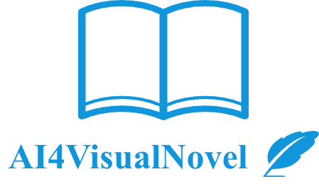
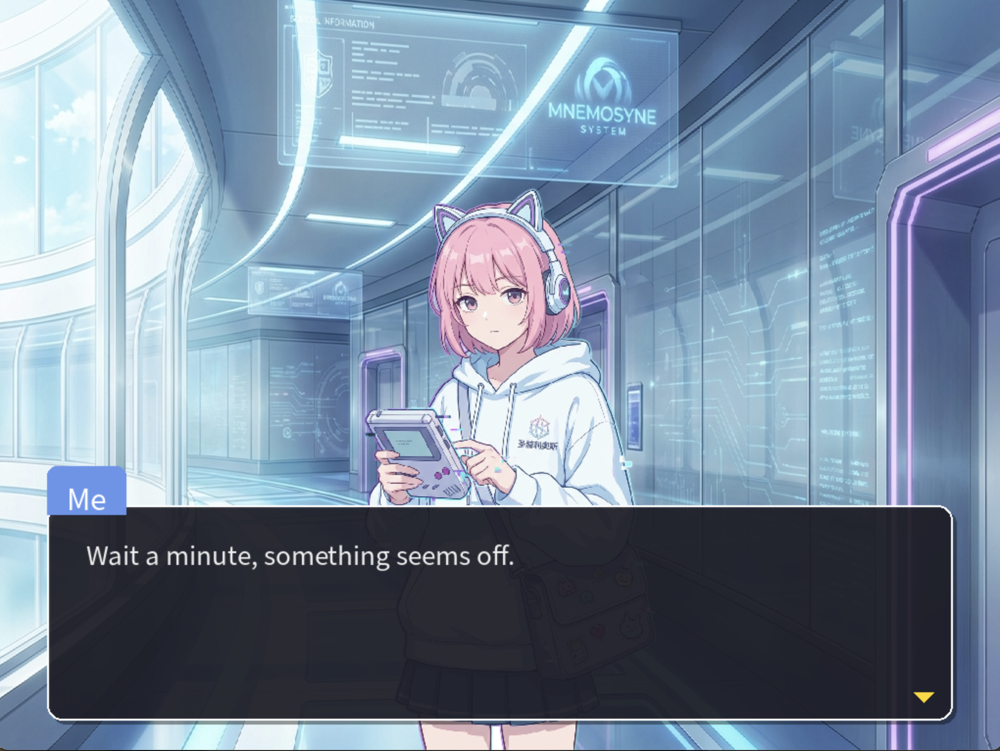
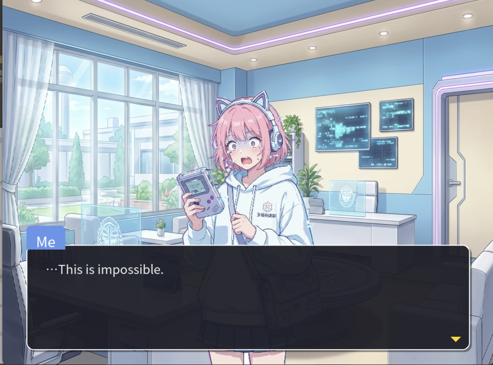
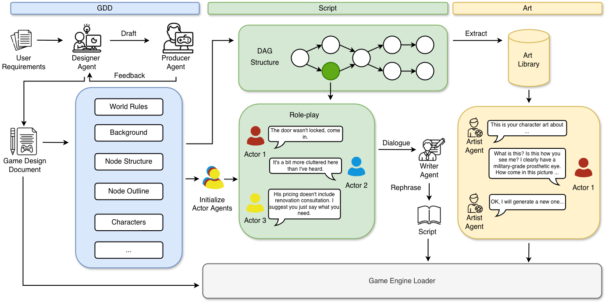

<p align="center">
    
</p>
<h3 align="center">
<b>AI4VisualNovel: A Role-Play Driven Multi-Agent Framework for
Topological Branching Narrative Generation and Visual Synthesis in Visual
Novel</b>
</h3>

`AI4VisualNovel` is an end-to-end framework specifically designed for **creating high-quality, multi-branch visual novels via a role-play driven multi-agent system**.
You only need to input your requirement, and the framework will generate the final game.

Unlike prior approaches that focus on linear narrative generation or struggle with cross-modal consistency, `AI4VisualNovel` proposes a **Topological Sort-based DAG (Directed Acyclic Graph) mechanism** , which allows for **causally consistent** non-linear storytelling and complex plot branching management. This design makes `AI4VisualNovel` **highly robust for generating long-form, immersive interactive narratives** where player choices genuinely impact the story direction.

`AI4VisualNovel` introduces a **novel "Actor Agent" paradigm** that participates in both dialogue generation and visual auditing. By simulating a professional studio pipeline (Producer, Writer, Actor, Artist) , it enables the generation of **persona-aligned character sprites** and authentic dialogue, ensuring that visual assets strictly adhere to character settings rather than generic descriptions. The framework directly outputs **playable game**, bridging the gap between LLM creativity and executable interactive media.

## 📰 News
- [2026.03] The framework now supports custom original characters—bring your OC to life and create a story that is truly your own!
- [2026.01] Code released! The paper is coming soon...


## 📺 Output Game Preview
<p align="center">
  
  
</p>


## 🏗️ Framework Overview
<p align="center">
    
</p>


## 🛠️ Installation

Follow these steps to set up your development environment:

1.  **Clone the Repository**:
    ```bash
    git clone https://github.com/ttsmallHot/AI4VisualNovel.git
    cd AI4VisualNovel
    ```

2.  **Install Dependencies**:
    ```bash
    conda create -n AI4VisualNovel python=3.10
    conda activate AI4VisualNovel
    pip install -r requirements.txt
    ```

3.  **Configure Environment**:
    Fill in the parameters in the `.env` file as instructed before starting.

---

## 🎮 Visual Novel Generation & Execution

### Web Dashboard

Start the local dashboard to create games, upload character references, edit story graphs and scripts, preview or regenerate visual assets, play games in the browser, and export Ren'Py projects:

```bash
python dashboard/server.py --port 8765
```

Open `http://127.0.0.1:8765`. The interface is in English, and the library scans `games/` by default. Generated games, API credentials, logs, and build outputs are kept out of Git; a fresh clone starts with an empty library. See [dashboard/README.md](dashboard/README.md) for configuration and workflow details.

### 1. Story Generation
Start the multi-agent collaboration to generate world settings, story graph, scripts, and visual assets. You can provide your requirements via a text file example as follows:

```yaml
requirements:
  file_path: games/visual_novel_creator/requirements.txt

oc:
  characters:
    - id: Nanami
      name: Nanami
      gender: female
      is_protagonist: true
      personality: ""
      appearance: ""
      background: ""
      neutral_image_path: games/your_game_name/images/characters/Nanami/neutral.png
```

```bash
# Generate by phases (recommended)
python main.py --mode design --project games/your_game_name --input-file input.yaml
python main.py --mode script --project games/your_game_name
python main.py --mode render --project games/your_game_name

# Or generate with empty requirements (AI will decide everything)
python main.py --mode design --project your_game_name
python main.py --mode script --project your_game_name
python main.py --mode render --project your_game_name
```
*   **Outputs**: A project name creates or opens `games/<project_name>`. An explicit directory path is also accepted. Existing `data/<project_name>` projects remain readable for compatibility.
*   **Dashboard library**: Only game folders inside `games/` are listed by default. Unrelated folders without visual-novel project files are ignored.
*   **Runtime files**: Logs and generated builds are stored under the project's hidden `.ai4vn/` directory.
*   **Design phase note**: `design` uses a two-step pipeline — Step1 generates outline (`story_outline.groups`), Step2 generates `story_graph` and writes it to the selected project directory.

### 2. Play the Game
Execute the built-in Pygame-based engine to experience the generated story:
```bash
python main.py --mode play --project your_game_name
```
*Note: You can also utilize other game engines (e.g., Unity, Ren'Py) to load the formatted data in the selected project folder for a more polished user experience.*

### 3. Export to Ren'Py

```bash
# Export Ren'Py project from existing generated data
python main.py --mode export-renpy --project your_game_name
```

After running this command, the required `script.rpy` and assets are generated in `<project>/.ai4vn/builds/renpy_project/`.

### 4. Packaging & Distribution
If you want to distribute your Pygame masterpiece, build a standalone executable to share your game.

- **For Windows**:
  ```batch
  pyinstaller --onefile --windowed --name "your_game_name" --add-data "data/your_game_name;data/your_game_name" main.py
  ```
- **For macOS**:
  ```bash
  pyinstaller --onefile --windowed --name "your_game_name" --add-data "data/your_game_name:data/your_game_name" main.py
  ```

## 📜 License
This project is licensed under the [Apache License 2.0](LICENSE).
  
